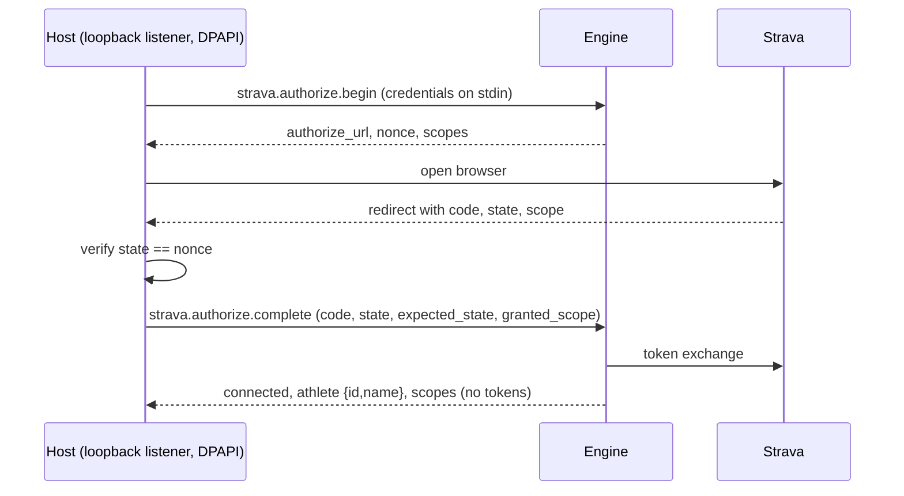

# Desktop integration contract (1.0)

The Python engine is the only migration engine. A desktop host (the future JuhoRunLab app)
drives it through `polar-to-strava-engine`, never by parsing CLI text. Specification:
[SPEC-004](../specs/004-desktop-integration-contract.md). Field-by-field CLI parity:
[parity matrix](desktop-parity-matrix.md). Example lines:
[contract examples](desktop-contract-examples.md). JSON Schema of every envelope:
[`contract/contract-1.0.schema.json`](contract/contract-1.0.schema.json).

## Transport

```text
polar-to-strava-engine <command>          # or: python -m integration <command>
```

- **stdin:** first line = one JSON request object (unknown fields are rejected). Later lines
  are control messages: `{"type": "cancel"}`. With `"cancel_on_stdin_close": true` in the
  request, closing stdin also cancels. `SIGINT`/`SIGTERM`/`CTRL_BREAK` cancel too.
- **stdout:** JSON Lines, UTF-8, `\n`, flushed per line. Nothing else is ever written there.
- **stderr:** human help text only; never secrets.
- **Envelope:** `{"contract":"1.0","type":"event|result|error","seq":N,"time":...,"command":...,"run_id":...}`
  plus type specific fields. `seq` starts at 1 and is gap free. Every run ends with exactly
  one `result` or `error` line.
- **Exit codes:** `0` success, `1` domain failure or `completed_with_failures`, `2` invalid
  request/unknown command, `3` workspace locked, `130` cancelled.
- **Versioning:** minor versions only add fields/events/commands; a removal or rename is a
  major version. Check `version` (`contract`) at start-up and ignore unknown fields/events.

## Commands

| Command | Request (besides `workspace`) | Writes | Network |
| --- | --- | --- | --- |
| `version` | none | no | no |
| `audit` | `source`, `config?`, `overwrite?`, `incremental?`, `workers?` | workspace | no |
| `audit.dry_run` | `source`, `config?` | none | no |
| `status` | `details?` | reconciles recovery DB when no writer is active | no |
| `activity.list` | filters: `migration_status[]`, `sport`, `upload_state[]`, `from_date`, `to_date`, `reason`, `outside_current_eligible`, `offset`, `limit` | as `status` | no |
| `activity.get` | `activity_id` | as `status` | no |
| `upload.dry_run` | `selector` | recovery DB (blockers, like the CLI) | no |
| `upload.run` | `selector`, `max_in_flight`, `rate_limit_reserve`, `credentials?`, `token_store?` | recovery DB | Strava |
| `reset` | `activity_id` | recovery DB (protected, no `force`) | no |
| `report.export` | `destination`, `format` (`json`/`csv`/`markdown`) | export file | no |
| `strava.connection` | `token_store?` | none | no |
| `strava.authorize.begin` | `redirect_uri`, `features[]`, `credentials?` | none | no |
| `strava.authorize.complete` | `code`, `state`, `expected_state`, `granted_scope`, `features[]` | token store | Strava |
| `strava.disconnect` | `token_store?` | token store | no |
| `timezone.list_unresolved` | `from_date`, `to_date`, `sport`, `reason`, `config?` | none | no |
| `timezone.preview` | `choices[]`, `iana_zone?` | none | no |
| `timezone.apply` | as preview plus `source`, `confirm`, `config?`, `incremental?` | config + audit outputs | no |

`selector` is exactly one of `{"limit": n}`, `{"activity_id": "..."}`, `{"all": true}`, optionally
with `from_date`/`to_date`. Writing commands (`audit`, `upload.*`, `reset`, `timezone.apply`)
hold the workspace lock.

## Events

| Event | When | Key fields |
| --- | --- | --- |
| `audit.phase` | phase change | `phase`, `total` |
| `audit.progress` | throttled | `completed`, `total`, `percent`, `fit_valid`, `fit_generated`, `fit_reused`, `cache_hits`, `warnings`, `failed`, `skipped_existing`, `elapsed_s`, `rate_per_s`, `eta_s` (null until reliable) |
| `audit.activity` | per source after the audit | all audit row fields (incl. `activity_name`, `average_hr`, `maximum_hr`, `ascent_m`; additive within 1.0), `migration_status`, `migration_reason`, `fit{...}` |
| `upload.event` | every recovery event | `identifier`, `action`, `reason_codes[]`, `review_upload_ids[]`, `wait_reason`, `next_poll_at`, `polls_remaining`, `failures_remaining`, `batch` |
| `upload.progress` | throttled and at batch end | the status counters, `run_total`, `current` |
| `rate.snapshot` | with progress and at end | `overall`/`read` windows, `reserve`, `max_in_flight`, `in_flight`, `wait`, `polling` |
| `rate.wait` | reserve wait begins | `reason`, `seconds`, `resume_at` |

Rate windows are `{usage, limit, remaining, known}`; absent headers give `null` and
`known:false`, never `0`. `upload.progress` counters keep the CLI's definitions: recovery
categories count **activities and may overlap**, `capacity_jobs`/`duplicate_review_stops` count
**attempts**, and `semantics[]` repeats that for display. `run_done` is `null` (the CLI does not
populate it either).

## Errors

`{"type":"error","error":{"code","message","field","details","retryable"}}`. `retryable` means
"the same command may be run again later" (for example a locked workspace), never "an upload may be
re-sent". Codes: `invalid_request`, `unknown_command`, `workspace_not_found`, `workspace_locked`,
`validation_error`, `configuration_error`, `domain_error`, `credentials_missing`, `not_authorized`,
`insufficient_scope`, `state_mismatch`, `invalid_redirect_uri`, `oauth_failed`, `unknown_activity`,
`confirmation_required`, `validation_failed`, `internal_error` (type name only; no traceback).

## Cancellation

Cancel is cooperative and never interrupts a request in flight. Audit: stops submitting, discards
pending work, writes no report or manifest (previous outputs remain intact), result
`status: "cancelled"`. Upload: finishes the current request, records its outcome, stops between
requests, and interrupts rate-limit waits; result `cancelled` with
`notice: uncertain_outcomes_are_never_retried_automatically`. Uncertain submissions stay in review;
a later run observes known upload IDs but never posts the same activity again.

## Workspace lock and recovery database

`<workspace>/.migration.lock` holds an OS lock for the whole of a writing command; the CLI takes
the same lock for `audit`, `strava upload` and `strava reset`, so the CLI and the engine exclude each
other (exit code 3 / structured `workspace_locked`). The OS drops the lock if a process dies.
Read commands do not wait for it; while a writer is active `status` skips reconciliation
(`reconciled: false`). The recovery database `migration-state.sqlite3` is unchanged and remains
CLI-compatible; the host keeps its own data in a separate application database and never writes the
recovery database directly.

## Strava connection and secrets



- Credentials are sent per request on stdin (or, for the CLI, the environment); they are redacted by
  key and by value from every output.
- Tokens are stored by the engine in the workspace token store: plaintext JSON (CLI compatible, the
  default) or `token_store: {"kind": "dpapi"}`, encrypted with Windows DPAPI for the current user
  (entropy `polar-to-strava/strava-tokens/v1`, readable by the host with `ProtectedData`).
- Scopes: `migration` requests `activity:write`; `sync` requests `activity:read_all`. Insufficient
  grants fail with `insufficient_scope` and store nothing. `upload.run` requires `activity:write`.
- Reauthorizing, reconnecting or disconnecting never touches the recovery history.

## Timezone workflow

`timezone.list_unresolved` → `timezone.preview` → user confirmation → `timezone.apply`.

- Only `requires_configuration` activities qualify. Sources with authoritative timezone data are
  refused (`authoritative_timezone`).
- An IANA zone is a *suggestion* the user chose explicitly, evaluated at the activity's date with
  historical rules. Ambiguous or nonexistent local times at a daylight-saving change are errors
  (`ambiguous_local_time`, `nonexistent_local_time`); offsets with seconds are rejected. The host
  location is never used. Offsets keep the existing `+HH:MM` range (-14:00..+14:00).
- `timezone.apply` needs `confirm: true`, validates everything first (nothing is written on
  failure), merges into the `config_version 1` file atomically (default
  `<workspace>/migration-config.json`), reruns the audit and reports each activity's new status. It
  never uploads or retries anything.

## Packaging and hosting

See [packaging](packaging.md) for the measured Windows executable, startup time and licensing.

## Future UI component mapping

See [SPEC-004](../specs/004-desktop-integration-contract.md#ui-component-mapping-future-informative).
